# Nexus – Complete Workflow, Technical Flow and ERD

**Products covered:** Barcode AutoPrint (PRN) · GSTR2Tally · Mothys Inventory (and any future "universal" project)
**Stack:** Django + DRF backend (`backend/`), React + Vite SPA (`frontend/`), SQL Server database `SaiInfosysNexus`
**Source of truth:** this document was written from the code (`models.py`, `services.py`, `device.py`, `urls.py`, `App.jsx`) on branch `nexus-web`. Where a fact comes from code, the file is named so it can be checked.

> Diagrams are Mermaid. They render on GitHub, and in VS Code with the extension **"Markdown Preview Mermaid Support"** (open the preview with `Ctrl+Shift+V`).

---

## Contents
1. [Big picture](#1-big-picture)
2. [Common foundation (staff login, roles, security)](#2-common-foundation)
3. [Barcode AutoPrint (PRN)](#3-barcode-autoprint-prn)
4. [GSTR2Tally](#4-gstr2tally)
5. [Mothys Inventory (Universal Integration)](#5-mothys-inventory-universal-integration)
6. [Dashboard and reports](#6-dashboard-and-reports)
7. [Frontend map](#7-frontend-map)
8. [Side-by-side comparison](#8-side-by-side-comparison)
9. [Combined ERD](#9-combined-erd)
10. [Known gaps and things to verify](#10-known-gaps-and-things-to-verify)

---

## 1. Big picture

Nexus is the **central licensing and customer-management server** for Sai Infosys products. Each product (the customer's own app) calls Nexus to register customers, verify logins, check licences and report usage. Sai Infosys staff use the Nexus web portal to approve customers, activate licences, manage devices, and see dashboards.

### 1.1 Three licensing families (one Django app each)

| Product | Django app | URL prefix | Who calls Nexus | How the product proves itself | Licence enforced where |
|---|---|---|---|---|---|
| **Barcode AutoPrint** (`prn-auto-print`) | `registrations` | `/api/device/prn-auto-print/…` and `/api/portal/prn-auto-print/…` | Windows agent on the customer's PC | **Ed25519 device signature** on every request + customer token | **On the customer PC**, via a Nexus-**signed entitlement** (offline lease up to 7 days) |
| **GSTR2Tally** (`gstr2tally`) | `tallysl` | `/api/v1/tally-sl/gstr2tally/…` | Local GSTR client that reads TallyPrime | `X-Product-Key` header + customer **bearer session token** | **On Nexus**, checked per session / licence status call |
| **Mothys Inventory** (`MOTHYS`) and future projects | `integrations` | `/api/integrations/v1/…` | The project's own **backend** (FastAPI), server-to-server | `X-Client-Id` + `X-Client-Secret` | **On Nexus**; the project backend introspects the session |

Staff-side APIs: `/api/auth/…`, `/api/config/…`, `/api/projects/
/…` (PRN), `/api/v1/tally-sl-admin/…` (GSTR), `/api/integrations/admin/…` (Mothys), `/api/dashboard/…`.

### 1.2 Architecture

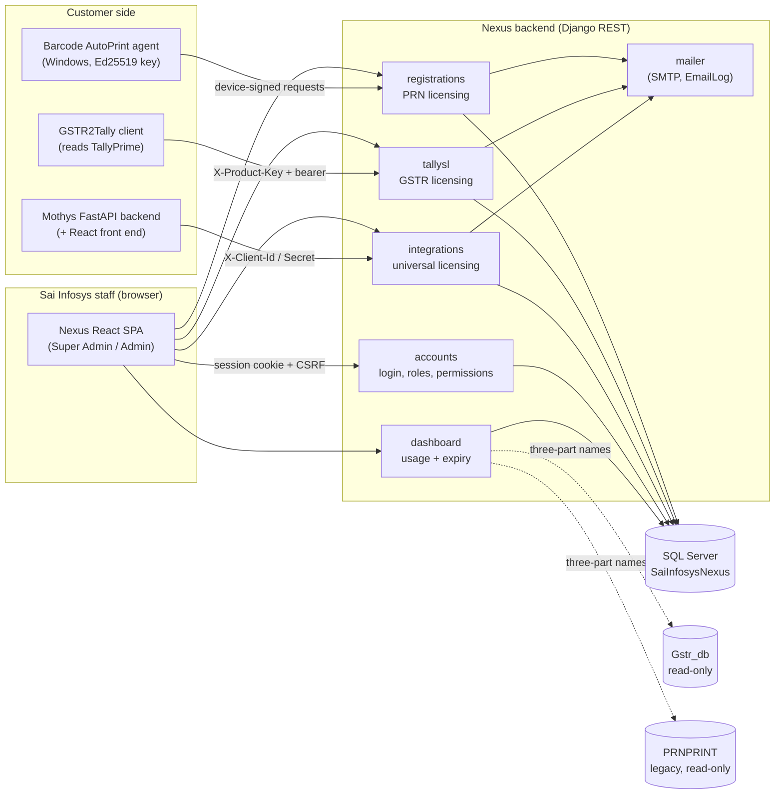

### 1.3 Isolation rule

The three product families are **deliberately separate tables and code**. `tallysl_*` tables never join to `registrations` tables, and `integration_*` tables never join to either (stated in the docstrings of `tallysl/models.py` and `integrations/models.py`). Only these are shared: Django `User`, `UserProfile`, and the staff permission model. `ProjectCustomer.project` (PRN) is a **string code**, not a foreign key.

---

## 2. Common foundation

### 2.1 Staff roles and permissions

| Role (`accounts.constants.Role`) | Meaning |
|---|---|
| `SUPERADMIN` | Full control. Only role that can approve first activations, transfer or revoke devices, rotate project credentials, set permissions. |
| `ADMIN` | Has **only what a Super Admin grants**. Default grant is nothing (`DEFAULT_ADMIN_ACTIONS = frozenset()`). |

Permissions are **per user, per module/project**:

* **PRN and generic modules** – `UserModulePermission` (one row per user + module) with flags: entry, view, edit, delete, extend_trial, cancel_trial, inactivate, approve, device_transfer, renew, reports, export_print.
* **GSTR2Tally** – `TallyAdminPermission` (one row per user + product) with flags: view, entry, edit, delete, license_activation, license_management, reports, device_management.
* **Global switch list** – `AdminPermission` (a heading ON/OFF for the whole Admin role).

### 2.2 Staff login flow

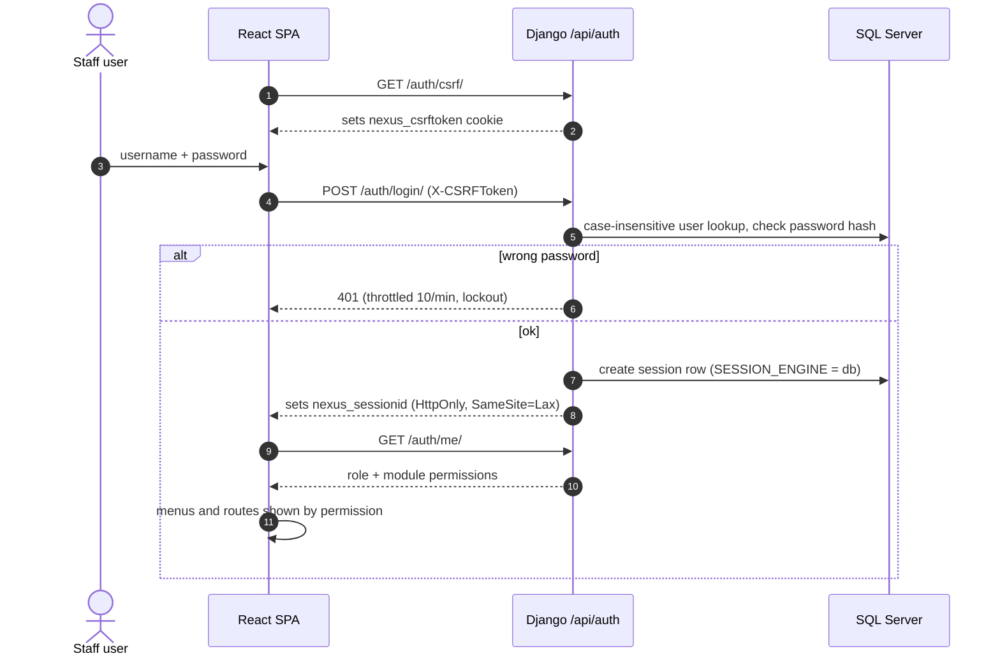

* Session timeout is **sliding** (`SESSION_SAVE_EVERY_REQUEST`, default 8 h).
* Anonymous requests get **401**; CSRF or permission denial gets **403**, so the SPA can tell them apart (`core/authentication.py`).
* Passwords are **case-insensitive** (casefolded before hashing) and have no complexity rules, by design (`settings.py`).

### 2.3 Security conventions used by every product

| Concern | What the code does |
|---|---|
| Secrets at rest | Passwords, activation keys, product keys, client secrets, session tokens are stored **only as hashes** (SHA-256 or HMAC). Raw values are shown or emailed once. |
| Lockout | Wrong passwords counted (`failed_logins`, `locked_until`); 15-minute lockout (`CUSTOMER_LOCKOUT_MINUTES`). |
| Throttling | Per-IP / per-client rates in `REST_FRAMEWORK.DEFAULT_THROTTLE_RATES` (login, portal, device, device_enroll, device_public). |
| Anti-enumeration | Wrong serial and wrong key give the **same** error; forgot-password / recover-username answer neutrally. |
| Audit | Every sensitive step is written to an append-only audit table (`LicenseAuditLog`, `TallyAuditLog`, `IntegrationAudit`). |
| Email | `EmailLog` records who/what/status. Bodies are never stored. `accepted` means "handed to the mail server", **not** "delivered". |
| Errors | `{"message","code","errors"}` (PRN, GSTR) · `{"ok":false,"error":{"code","message"},"request_id"}` (Mothys). |

### 2.4 Staff ERD (shared tables)

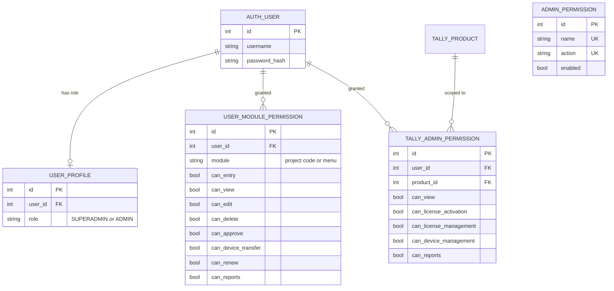

---

## 3. Barcode AutoPrint (PRN)

Project code `prn-auto-print`. App: `backend/apps/registrations`. Detailed contract: `docs/DEVICE-LICENSING.md`.

### 3.1 Business workflow (what happens, in order)

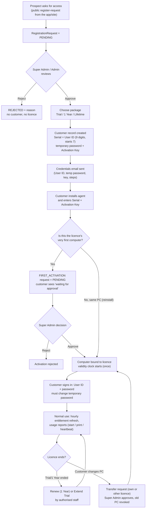

**Package rules** (`registrations/models.py`, `device.py`, `docs/DEVICE-LICENSING.md`):

| Package | Stored value | Validity | Notes |
|---|---|---|---|
| Trial | `TRIAL` | first activation + **7 days** (`TRIAL_DAYS_BY_PRODUCT`) | Longer only after authorised **Extend Trial** |
| 1 Year | `ONE_YEAR` | first activation + 365 days | Moves only through **Renew** (recorded in `LicenseRenewal`) |
| Lifetime | `LICENSED` (kept for back-compat) | no expiry (`expires_at = null`) | Never in expiry reports |

Status values: `ACTIVE`, `TRIAL_CANCELLED`, `INACTIVE`. Device states shown to staff: `not_activated`, `active`, `revoked`, `transfer_pending`.

### 3.2 Technical flow – registration to activation

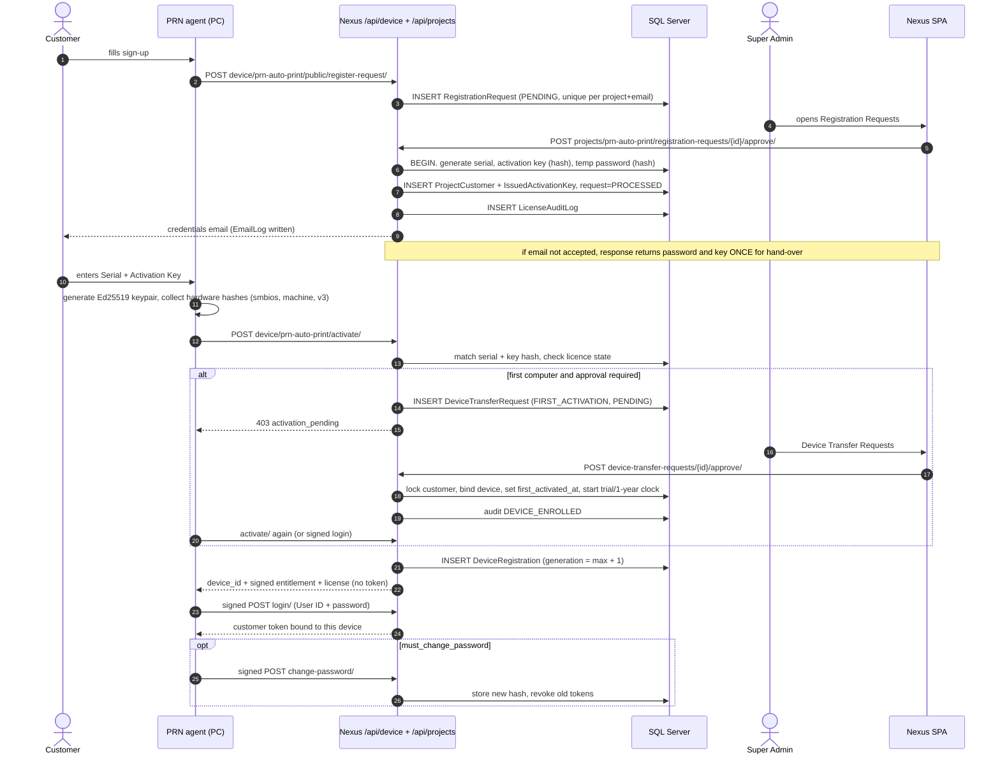

### 3.3 Technical flow – every signed request and the offline lease

Every call after enrolment carries:

`X-Device-Id`, `X-Device-Timestamp` (UTC, ±5 min), `X-Device-Nonce` (single use), `X-Device-Signature` = Ed25519 over
`METHOD \n PATH \n TIMESTAMP \n NONCE \n sha256(body)`; customer calls also send `X-Customer-Token`.

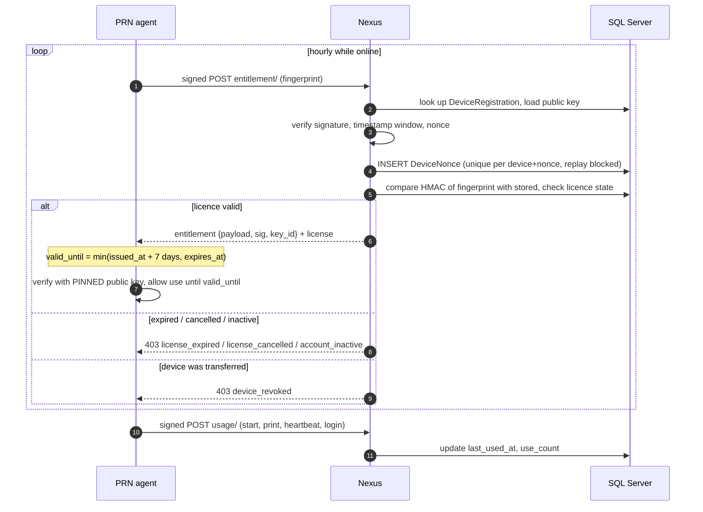

* **Licence vs lease:** the *licence* end (`expires_at`) is set once at first activation and changes only by extension or renewal. The *lease* (`valid_until`) is a short 7-day permission slip the agent must keep renewing online.
* **Signing:** Ed25519 private key lives only in the server environment (`LICENSE_SIGNING_PRIVATE_KEY`). The agent pins the matching public key; rotation is by `key_id`.
* Background `entitlement/` refreshes and activation do **not** count as usage; login, start, print and heartbeat do.

### 3.4 Technical flow – device change

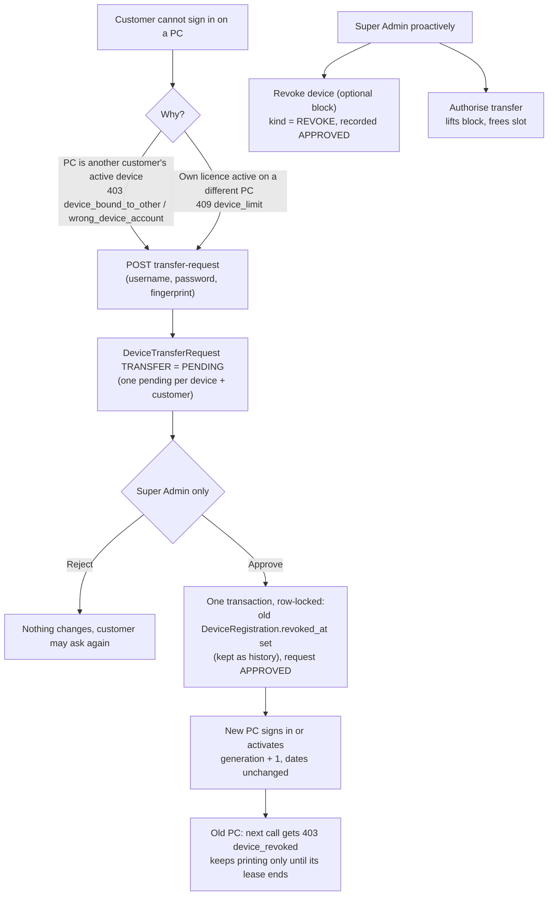

An **Activation Key or Serial alone never moves a licence** – a transfer needs the customer's password as proof of ownership.

### 3.5 State machines

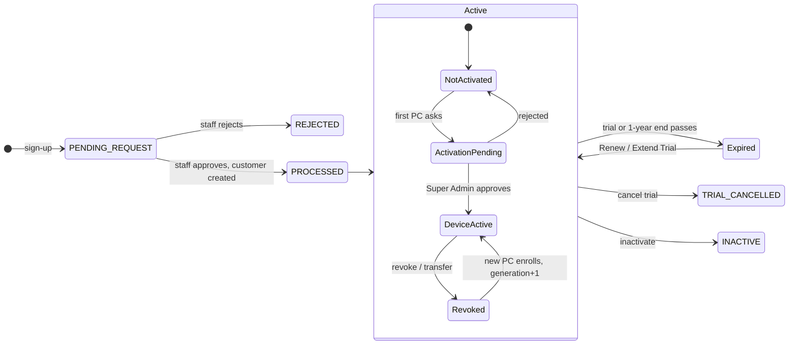

### 3.6 ERD – Barcode AutoPrint

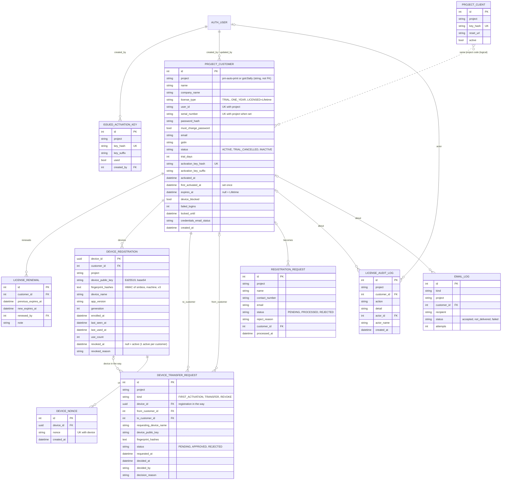

**Database rules that matter:** `uniq_active_device_per_customer` (one non-revoked device per customer) · `uniq_customer_user_id_per_project` · `uniq_customer_serial_per_project` · `uniq_pending_request_per_project_email` · `uniq_pending_first_activation_per_customer` · `uniq_pending_transfer_per_device_customer` · `uniq_device_nonce`.

### 3.7 Endpoint map (PRN)

| Caller | Endpoints (under `/api/`) |
|---|---|
| Public (rate-limited 10/min/IP) | `device/prn-auto-print/public/{register-request, register-request/status, forgot-password, recover-username, reset-password, keys}` |
| Agent, no signature (credentials in body) | `device/…/enroll/`, `activate/`, `transfer-request/`, `transfer-request/status/` |
| Agent, **signed** | `device/…/entitlement/`, `login/`, `usage/`, `license/status/`, `account/`, `change-password/`, `register-request/`, `forgot-password/`, `recover-username/` |
| Connected project backend (project key) | `portal/prn-auto-print/{register-request, login, forgot-password, reset-password, change-password, license/status, account, …}` |
| Staff (session) | `projects/
/customers/…`, `registration-requests/…`, `activation-key/`, `serial-number/`, `temporary-password/`, `customers/<id>/{extend-trial, cancel-trial, inactivate, renew, renewals, reset-password, resend-credentials, reissue-activation-key, device, device/revoke, device/transfer}`, `device-transfer-requests/…`, `activity/`, `sync/`, `reports/license-expiry`, `reports/usage` |

---

## 4. GSTR2Tally

Product code `gstr2tally`. App: `backend/apps/tallysl` (isolated `tallysl_*` tables). Detailed contract: `docs/TALLY-SL-API-CONTRACT.md`, `docs/TALLY-SL-LICENSING.md`.

Key identity rule: **Tally Serial Number = Product Serial Number = User ID.** The GSTR client **reads** it from TallyPrime; Nexus never generates it.

### 4.1 Business workflow

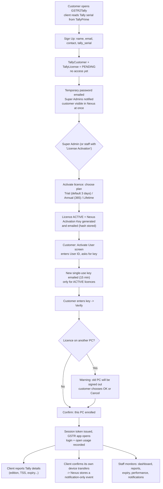

Notable differences from PRN: **no per-device cryptographic signing and no Super Admin approval of a new device** – the customer confirms a device change themselves after proving the emailed key. Nexus is told about completed transfers by the app (`TallyTransferEvent`); it does not approve them.

### 4.2 Technical flow – registration to session

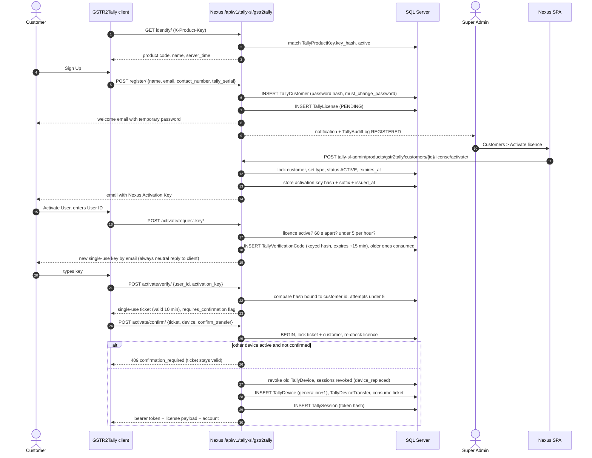

### 4.3 Technical flow – daily use, password reset, transfer notice

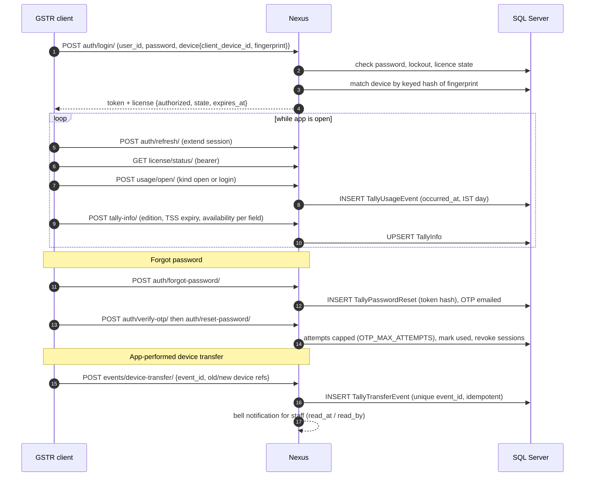

**Licence state** (`tallysl/services.license_state`): `pending` → `active` → `expired` (type ≠ Lifetime and `expires_at` ≤ now) · `cancelled` (TRIAL_CANCELLED) · `inactive`.

**Plans** (`activate_license`): Trial = N days (1–365, default `TallyProduct.default_trial_days = 3`) · Annual = 365 days (stored as `LICENSED`) · Lifetime = no expiry.

**Staff licence actions:** activate, extend trial, cancel trial, renew, inactivate, reissue key, revoke device; credentials: resend / reset (`credentials/<action>/`). Each needs the matching `TallyAdminPermission` flag.

### 4.4 ERD – GSTR2Tally

```mermaid
erDiagram
    TALLY_PRODUCT ||--o{ TALLY_PRODUCT_KEY : "keys"
    TALLY_PRODUCT ||--o{ TALLY_CUSTOMER : "customers (PROTECT)"
    TALLY_PRODUCT ||--o{ TALLY_TRANSFER_EVENT : "events"
    TALLY_PRODUCT ||--o{ TALLY_ADMIN_PERMISSION : "staff grants"
    TALLY_CUSTOMER ||--|| TALLY_LICENSE : "one licence"
    TALLY_CUSTOMER ||--o| TALLY_INFO : "tally details"
    TALLY_CUSTOMER ||--o{ TALLY_DEVICE : "devices"
    TALLY_CUSTOMER ||--o{ TALLY_DEVICE_TRANSFER : "device history"
    TALLY_CUSTOMER ||--o{ TALLY_TRANSFER_EVENT : "app-reported transfers"
    TALLY_CUSTOMER ||--o{ TALLY_VERIFICATION_CODE : "activation keys"
    TALLY_CUSTOMER ||--o{ TALLY_SESSION : "sessions"
    TALLY_CUSTOMER ||--o{ TALLY_PASSWORD_RESET : "resets"
    TALLY_CUSTOMER ||--o{ TALLY_USAGE_EVENT : "usage"
    TALLY_CUSTOMER |o--o{ TALLY_AUDIT_LOG : "audit"
    TALLY_DEVICE |o--o{ TALLY_SESSION : "bound to"
    TALLY_DEVICE |o--o{ TALLY_USAGE_EVENT : "on device"
    TALLY_DEVICE |o--o| TALLY_INFO : "reported_device"
    TALLY_DEVICE |o--o{ TALLY_DEVICE_TRANSFER : "from / to"
    AUTH_USER |o--o{ TALLY_LICENSE : "activated_by"

    TALLY_PRODUCT {
        int id PK
        string code UK "gstr2tally"
        string name
        string kind
        bool active
        int default_trial_days "3"
        string password_reset_url
        string activation_link_base
    }
    TALLY_PRODUCT_KEY {
        int id PK
        int product_id FK
        string key_hash UK "X-Product-Key"
        bool active
    }
    TALLY_CUSTOMER {
        int id PK
        int product_id FK
        string tally_serial "UK with product = User ID"
        string name
        string email
        string contact_number
        string company_name
        string gstin
        string password_hash
        bool must_change_password
        int failed_logins
        datetime locked_until
        string welcome_email_status
        datetime registered_at
    }
    TALLY_LICENSE {
        int id PK
        int customer_id FK "one-to-one"
        string license_type "TRIAL, LICENSED, LIFETIME"
        string status "PENDING, ACTIVE, TRIAL_CANCELLED, INACTIVE"
        int trial_days
        datetime activated_at
        datetime expires_at "null = Lifetime or not started"
        string activation_key_hash
        string activation_key_suffix
        datetime activation_key_issued_at
        int activated_by FK
    }
    TALLY_INFO {
        int id PK
        int customer_id FK "one-to-one"
        string edition
        string tss_details
        int virtual_user_limit
        string license_administrator
        string gateway_server
        date tss_expiry_date "Tally expiry, not Nexus"
        text availability "verified or unavailable per field"
        int reported_device_id FK
    }
    TALLY_DEVICE {
        uuid device_id PK
        int customer_id FK
        string client_device_id
        string fingerprint_hash "keyed hash only"
        string device_name
        int generation
        datetime enrolled_at
        datetime revoked_at "1 active per customer"
        string revoked_reason
    }
    TALLY_DEVICE_TRANSFER {
        int id PK
        int customer_id FK
        string kind "ENROLLED, REPLACED, REVOKED"
        uuid from_device_id FK
        uuid to_device_id FK
        string performed_by
        string ip_address
    }
    TALLY_TRANSFER_EVENT {
        int id PK
        string event_id UK "idempotency"
        int product_id FK
        int customer_id FK
        string old_device_ref
        string new_device_ref
        string status "COMPLETED"
        datetime occurred_at
        datetime read_at
        string read_by
    }
    TALLY_VERIFICATION_CODE {
        int id PK
        int customer_id FK
        string code_hash
        int attempts
        datetime expires_at
        datetime verified_at
        string ticket_hash
        datetime ticket_expires_at
        datetime consumed_at
    }
    TALLY_SESSION {
        int id PK
        int customer_id FK
        uuid device_id FK
        string token_hash UK
        datetime expires_at
        datetime revoked_at
        string revoked_reason
    }
    TALLY_PASSWORD_RESET {
        int id PK
        int customer_id FK
        string token_hash UK
        datetime expires_at
        datetime used_at
        int attempts
    }
    TALLY_USAGE_EVENT {
        int id PK
        int customer_id FK
        uuid device_id FK
        string kind "open or login"
        datetime occurred_at
        date day "IST calendar day"
    }
    TALLY_USAGE_RULE {
        int id PK "single row, pk=1"
        int new_user_days "7"
        int speed_window_days "30"
        int speed_min_active_days "15"
    }
    TALLY_AUDIT_LOG {
        int id PK
        int product_id FK
        int customer_id FK
        string action
        string actor
        string ip_address
    }
    TALLY_ADMIN_PERMISSION {
        int id PK
        int user_id FK
        int product_id FK
        bool can_view
        bool can_license_activation
        bool can_license_management
        bool can_device_management
        bool can_reports
    }
```

### 4.5 Endpoint map (GSTR2Tally)

| Caller | Endpoints (under `/api/v1/tally-sl/<product>/` unless noted) |
|---|---|
| Product client (`X-Product-Key` only) | `identify/`, `register/`, `auth/login/`, `auth/forgot-password/`, `auth/reset-password/`, `auth/verify-otp/`, `auth/resend-credentials/`, `activate/request-key/`, `activate/verify/`, `activate/confirm/` |
| Product client + bearer token | `auth/refresh/`, `auth/logout/`, `auth/change-password/`, `session/`, `account/`, `license/status/`, `tally-info/`, `usage/open/`, `events/device-transfer/` |
| Staff (session + per-product permission), under `/api/v1/tally-sl-admin/` | `access/`, `products/`, `permissions/`, `dashboard/`, `notifications/`, `products/
/{customers, transfers}`, `customers/<id>/{credentials/<action>, license/<action>, device/revoke}`, `usage/<category>/`, `reports/{license-expiry, user-performance, tally-details}` (+ `/export/`) |

Management commands: `create_tally_product_key`, `import_gstr_customers`.

---

## 5. Mothys Inventory (Universal Integration)

Project code `MOTHYS` (seeded by migration `integrations/0002_seed_mothys`). App: `backend/apps/integrations`. Detailed contract: `docs/MOTHYS-INTEGRATION-HANDOFF.md`, `docs/UNIVERSAL-LICENSING-API-REFERENCE.md`.

**A new project is data, not code:** Super Admin creates an `IntegrationProject` row (URLs, serial format, trial days, device limit, transfer policy, email modes, usage rules), Nexus issues a `client_id` + one-time secret, and the project's backend calls the 12 universal APIs.

### 5.1 Business workflow

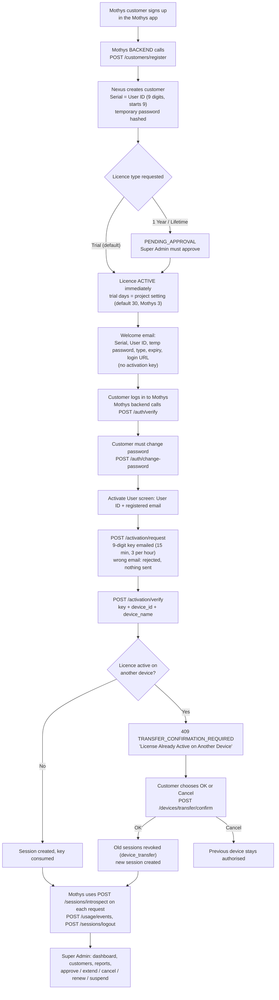

No Super Admin step and no extra email OTP is needed for a **device change** here (`transfer_policy = SELF`); a project can set `DISABLED` to forbid transfers.

### 5.2 Technical flow – the 12 universal APIs

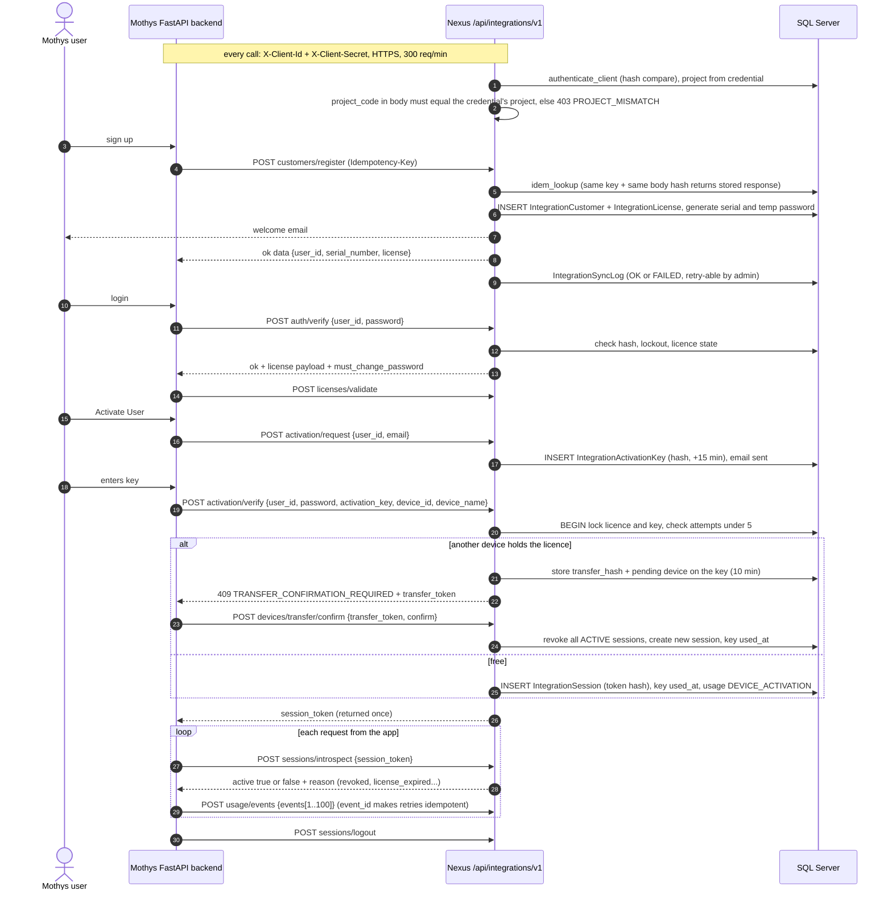

**Integration verification gate:** a project only becomes `ACTIVE` once it has really exercised `register`, `auth_verify`, `activation_verify`, `session_introspect`, `usage_event` (`IntegrationProject.REQUIRED_STEPS`, recorded in `verified_steps`).

**Licence states:** `PENDING_APPROVAL` · `ACTIVE` · `EXPIRED` (derived) · `SUSPENDED` · `CANCELLED`. Status shown to staff: pending, not_activated (valid licence, no device ever activated), active, expired, cancelled, inactive.

**Usage classes** (`integrations/usage.classify`, first match wins, non-overlapping): New (created ≤ `new_days`, default 7) → Not Used (no activity ever) → One-time (1 distinct day ever) → Speed (≥ `speed_min_days` = 15 distinct days in last 30) → Normal. Activity = `APP_OPEN`, `LOGIN`, `HEARTBEAT`, `DEVICE_ACTIVATION` (logout and transfer are not usage).

### 5.3 ERD – Mothys / universal integrations

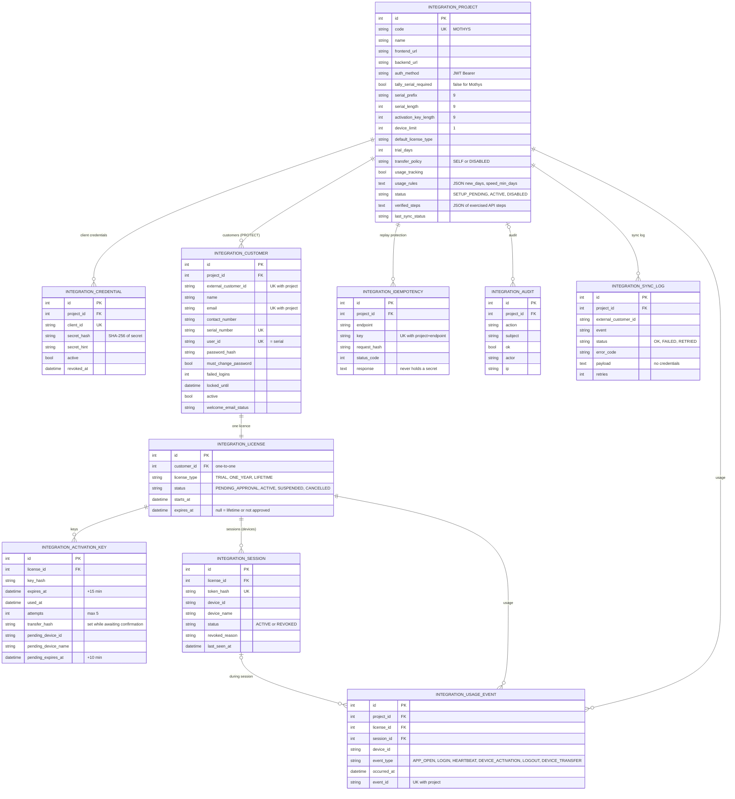

### 5.4 Endpoint map (Mothys / universal)

| Caller | Endpoints (under `/api/integrations/`) |
|---|---|
| Project backend (`X-Client-Id` + `X-Client-Secret`) | `v1/customers/{register, update, import}`, `v1/auth/{verify, change-password}`, `v1/licenses/validate`, `v1/activation/{request, verify}`, `v1/devices/transfer/confirm`, `v1/sessions/{introspect, logout}`, `v1/usage/events`, `v1/projects/<code>/config` |
| Super Admin (session) | `admin/dashboard/`, `admin/projects/…` (create, detail, rotate-credentials, test-connection, docs/<kind>, customers, audit), `admin/projects/<code>/{dashboard, product-customers, product-customers/<id>/<action>, reports/<kind>, export}`, `admin/licenses/<id>/approve/`, `admin/customers/<id>/resend-welcome/`, `admin/failed-sync/` + `/<id>/retry/` |

---

## 6. Dashboard and reports

`backend/apps/dashboard/usage.py` reduces every project to **one row per registered customer/device with its latest successful usage time**. Used and Not Used are filters over that single set, so the summary always equals the lists and nothing is counted twice.

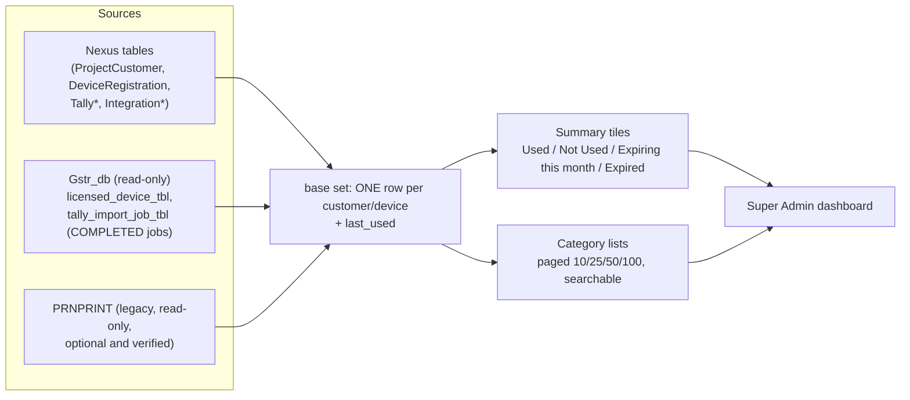

| Project | "Registered" means | "Used" means |
|---|---|---|
| GSTR2Tally | ACTIVE devices in `licensed_device_tbl` (+ unmatched ACTIVE Nexus registrations) | a `COMPLETED` import job attributed to the device |
| Barcode AutoPrint | ACTIVE-status Nexus customers (authoritative), merged by serial with legacy PRN rows only when that DB is configured, readable and verified | licence activated/validated, or the enrolled device really reported use (never mere record creation) |
| Mothys / universal | customers with licences | any activity event (see 5.2) |

**Expiring This Month** uses `expires_at` in the current calendar month, Asia/Kolkata, for ACTIVE Trial and 1-Year customers only (Lifetime excluded).

**Reports** (all with Export): License Expiry (all products), Usage, User Performance, Tally Details (GSTR), Customer Details (Mothys). The dashboard polls `GET /api/dashboard/sync/` and per-project `…/sync/` – a cheap version fingerprint (newest audit id + customer count) – to refresh open screens.

---

## 7. Frontend map

React Router v6 in `frontend/src/App.jsx`. Public: `/login`. Everything else is behind `ProtectedRoute` inside `AppLayout`; menu items come from `layouts/navigation.js` and the `/auth/me` permissions.

| Area | Routes | API client |
|---|---|---|
| Overall | `/dashboard` | `api/dashboard.js` |
| Barcode (generic project pages) | `/projects/:slug/{add, customers, customers/:id/edit}` · `/reports/license-expiry` · `/reports/usage` | `api/registrations.js`, `api/reports.js` |
| GSTR2Tally | `/tally/:product/{dashboard, customers, customers/:id, transfers, usage/:category}` · `/tally/reports/{license-expiry, tally-details, user-performance}` | `api/tallysl.js`, `context/TallyAccessContext.jsx` |
| Mothys / universal | `/product/:code/{dashboard, customers, customers/:id}` · `/mothys/reports/{license-expiry, customer-details, user-performance}` | `api/integrations.js` |
| Project management (Super Admin, flag-gated) | `/project-management`, `/add`, `/status`, `/:code/integration` | `api/integrations.js` |
| Components worth knowing | `DeviceManagement`, `DeviceTransferRequests`, `RegistrationRequests`, `LicenseActions`, `ReissueActivationKey`, `ResendCredentials`, `ApprovalGate`, `ConfigurationDrawer` | |

---

## 8. Side-by-side comparison

| Topic | Barcode AutoPrint | GSTR2Tally | Mothys / universal |
|---|---|---|---|
| Django app | `registrations` | `tallysl` | `integrations` |
| Customer table | `ProjectCustomer` (project = string) | `TallyCustomer` (FK product) | `IntegrationCustomer` (FK project) |
| User ID | Nexus-generated serial (9 digits, starts 7) | **Tally serial from TallyPrime** | Nexus-generated serial (9 digits, starts 9) |
| Sign-up creates | A *request*; staff approve to create customer | Customer + **PENDING** licence immediately | Customer immediately; Trial ACTIVE, 1Y/Lifetime PENDING_APPROVAL |
| Who activates licence | Super Admin/Admin on approval | Super Admin (or "License Activation" permission) | Automatic for Trial; Super Admin approves others |
| Activation key | Issued at approval, emailed with credentials; Serial + Key at first run | Emailed on **customer request** (15 min, single use) | Emailed on customer request (9 digits, 15 min, 3/hr, 5 tries) |
| Trial length | 7 days (fixed per product) | 3 days default, set per activation (1–365) | Project setting (Mothys 3, default 30) |
| Device proof | Ed25519 signature + HMAC hardware hashes | Client device id + keyed fingerprint hash | `device_id` string from the project |
| New PC allowed by | **Super Admin approval** (first activation and any transfer) | Customer confirms after key | Customer confirms (policy SELF) |
| Where licence is enforced | On the PC from signed entitlement (7-day lease, hourly refresh) | Nexus session + status calls | Nexus session introspection |
| Caller credential | Device keypair (+ `ProjectClient` key for portal) | `X-Product-Key` | `X-Client-Id` + `X-Client-Secret` |
| Usage source | `DeviceRegistration.last_used_at / use_count` + legacy | `TallyUsageEvent` + `Gstr_db` jobs | `IntegrationUsageEvent` |
| Staff permission model | `UserModulePermission` | `TallyAdminPermission` | Super Admin only |
| Audit table | `LicenseAuditLog` | `TallyAuditLog` | `IntegrationAudit` + `IntegrationSyncLog` |

---

## 9. Combined ERD

High-level only (full columns are in sections 2.4, 3.6, 4.4 and 5.3). Dotted lines are **logical** links (matched by code or serial, no foreign key).

```mermaid
erDiagram
    AUTH_USER ||--o| USER_PROFILE : role
    AUTH_USER ||--o{ USER_MODULE_PERMISSION : grants
    AUTH_USER ||--o{ TALLY_ADMIN_PERMISSION : grants

    %% Barcode AutoPrint
    PROJECT_CUSTOMER ||--o{ DEVICE_REGISTRATION : devices
    PROJECT_CUSTOMER ||--o{ DEVICE_TRANSFER_REQUEST : requests
    PROJECT_CUSTOMER ||--o{ LICENSE_RENEWAL : renewals
    PROJECT_CUSTOMER |o--o{ REGISTRATION_REQUEST : "from sign-up"
    DEVICE_REGISTRATION ||--o{ DEVICE_NONCE : nonces
    AUTH_USER |o--o{ LICENSE_AUDIT_LOG : actor
    PROJECT_CUSTOMER |o--o{ LICENSE_AUDIT_LOG : about

    %% GSTR2Tally
    TALLY_PRODUCT ||--o{ TALLY_CUSTOMER : customers
    TALLY_PRODUCT ||--o{ TALLY_PRODUCT_KEY : keys
    TALLY_PRODUCT ||--o{ TALLY_ADMIN_PERMISSION : scoped
    TALLY_CUSTOMER ||--|| TALLY_LICENSE : licence
    TALLY_CUSTOMER ||--o| TALLY_INFO : "tally details"
    TALLY_CUSTOMER ||--o{ TALLY_DEVICE : devices
    TALLY_CUSTOMER ||--o{ TALLY_SESSION : sessions
    TALLY_CUSTOMER ||--o{ TALLY_USAGE_EVENT : usage
    TALLY_CUSTOMER ||--o{ TALLY_TRANSFER_EVENT : "transfer notices"
    TALLY_CUSTOMER ||--o{ TALLY_VERIFICATION_CODE : keys
    TALLY_CUSTOMER ||--o{ TALLY_PASSWORD_RESET : resets

    %% Mothys / universal
    INTEGRATION_PROJECT ||--o{ INTEGRATION_CREDENTIAL : credentials
    INTEGRATION_PROJECT ||--o{ INTEGRATION_CUSTOMER : customers
    INTEGRATION_CUSTOMER ||--|| INTEGRATION_LICENSE : licence
    INTEGRATION_LICENSE ||--o{ INTEGRATION_ACTIVATION_KEY : keys
    INTEGRATION_LICENSE ||--o{ INTEGRATION_SESSION : sessions
    INTEGRATION_LICENSE ||--o{ INTEGRATION_USAGE_EVENT : usage

    %% Cross-family logical links
    PROJECT_CUSTOMER }o..o{ TALLY_CUSTOMER : "dashboard merges by serial (no FK)"
    PROJECT_CUSTOMER }o..o{ INTEGRATION_CUSTOMER : "none, isolated by design"
```

---

## 10. Known gaps and things to verify

These come from the repository itself, not from guesses:

1. **Mothys handoff status** (`docs/MOTHYS-INTEGRATION-HANDOFF.md`): all 12 APIs passed the automated run on a local SQL Server, but the **Mothys FastAPI side was not built**, real SMTP delivery of the welcome email, browser checks of the Nexus screens, and production deployment were **not verified**.
2. **GSTR2Tally deployment** (`docs/TALLY-SL-LICENSING.md`): at the time that document was written the Tally SL v1 API was **local only**; the live server returned 404 for `identify/`. Re-check production before relying on it.
3. **Project Management menu** (`App.jsx`): routes are present but flag-gated, and the handoff notes describe it as on hold. Treat as not part of the live workflow until enabled.
4. **Email "accepted" ≠ delivered.** SMTP gives no receipt. When a mail server did not accept the credentials email, Nexus returns the temporary password and key once so staff can hand them over.
5. **PRN legacy database** (`PRNPRINT`) is optional. If it is unreadable the dashboard falls back to Nexus-only counts and says it is incomplete (`dashboard/usage.legacy_state`).
6. **Changing `DEVICE_EVIDENCE_KEY`** (defaults to `DJANGO_SECRET_KEY`) makes every stored PRN hardware hash unmatchable, so every device would need re-enrolment.
7. Working tree currently has **uncommitted edits** to the `integrations` module and docs (see `git status`); this document describes the code as it is on disk now.

### Source index

| Topic | Files |
|---|---|
| PRN models / logic | `backend/apps/registrations/{models,services,device,device_crypto,portal,device_views,portal_views,views}.py` |
| GSTR models / logic | `backend/apps/tallysl/{models,services,client_views,admin_views,events}.py` |
| Universal models / logic | `backend/apps/integrations/{models,services,views,admin_views,product_views,usage,spec}.py` |
| Staff auth / roles | `backend/apps/accounts/{models,constants,permissions,views}.py` |
| Dashboard | `backend/apps/dashboard/{usage,views}.py` |
| Settings | `backend/config/settings.py` (DB, sessions, throttles, licence keys, lockout) |
| URL maps | `backend/config/urls.py` and each app's `urls.py` |
| Frontend | `frontend/src/App.jsx`, `layouts/navigation.js`, `api/*.js`, `pages/{tally,product,integrations}/` |
| Existing detail docs | `docs/DEVICE-LICENSING.md`, `docs/TALLY-SL-API-CONTRACT.md`, `docs/TALLY-SL-LICENSING.md`, `docs/MOTHYS-INTEGRATION-HANDOFF.md`, `docs/UNIVERSAL-LICENSING-API-REFERENCE.md` |
